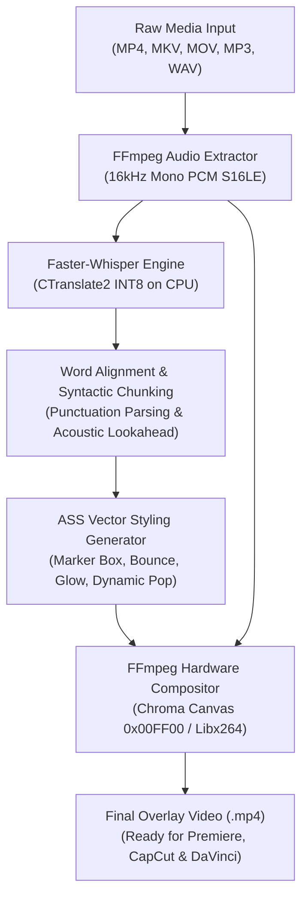

# ⚡ AI Caption Studio — Viral Chroma Overlays &  Subtitles

<p align="left">
  
  
  
  
  
</p>

An intelligent, local-first multimedia pipeline that transcribes speech in real time, computes word-level acoustic alignments, and renders viral kinetic karaoke subtitles as green/blue screen chroma overlays. Designed for content creators, video editors, and social media producers (TikTok, Instagram Reels, YouTube Shorts).

> 💡 **Community Edition (Developer Preview):** This repository features the open-source evaluation edition with automated 60-second processing per clip. For multi-hour batching, 50GB video support, and 1-click desktop installers, see the [Pro Edition Roadmap](#-community-vs-pro-edition).

---

## 🏗️ System Architecture



---

## ✨ Core Engineering Features

- 🧠 **Zero-GPU Local Neural Inference:** Powered by `faster-whisper` and CTranslate2 with `INT8` quantization on CPU. Achieves 4x–10x faster transcription than standard Whisper models with minimal RAM footprint (<150MB).
- 🎙️ **Millisecond Acoustic Alignment:** Standard Whisper outputs coarse sentence timestamps. AI Caption Studio extracts granular word boundaries and applies an algorithmic `0.05s` vocal lookahead offset to ensure subtitles hit precisely as the vocal cords vibrate.
- 📐 **Dual Aspect Ratio Support:** Native support for `9:16 Vertical` (1080x1920 for Reels, TikTok, Shorts) and `16:9 Landscape` (1920x1080 for YouTube, podcasts, and presentations).
- 🎨 **Chroma Key Overlays:** Renders captions over Pure Green (`#00FF00`), Studio Blue (`#0000FF`), or Transparent Black. Drag the exported MP4 directly into CapCut, Premiere Pro, or DaVinci Resolve and apply **Ultra Key / Chroma Key** for instant transparency.
- 🔤 **Dynamic Viral Typography:** Includes typography presets (Arial Black, Anton, Bangers, Montserrat 900, Outfit) with custom kinetic effects:
  - **Marker Box:** Solid highlight box behind the active spoken word.
  - **Typing Pop:** Progressive cumulative reveal with active-word scale zoom (135%).
  - **Glow & Bounce:** High-energy animated subtitles calibrated for social retention.

---

## 📊 Community vs. Pro Edition

| Capability | ⚡ Community Edition (This Repo) | 🚀 Pro Desktop Edition |
| :--- | :--- | :--- |
| **Max Processing Duration** | Up to 60 seconds per clip | **Unlimited (Full-length podcasts & 10hr+ audio)** |
| **File Size Limit** | 100 MB | **Up to 50 GB per file** |
| **Model Quantization** | Faster-Whisper Base / Small (CPU INT8) | Multi-model switch (Tiny, Base, Small, Medium, Large-v3) |
| **Installation** | Python & FFmpeg Command Line | **1-Click Windows (.exe) & macOS Native Installer** |
| **Batch Processing** | Single file upload | Multi-file drag-and-drop batch queue |
| **Custom Branding** | Predefined color palettes | Custom Hex, font file upload (.ttf/.otf), custom logos |
| **Offline Privacy** | 100% Local (Zero Cloud Upload) | 100% Local (Zero Cloud Upload) |

---

## 🚀 How to Use AI Caption Studio

### 1. Prerequisites
- **Python 3.10+** installed on your system.
- **FFmpeg** installed and accessible in your system `PATH`.
  - *Windows:* `winget install Gyan.FFmpeg` (or download from [ffmpeg.org](https://ffmpeg.org)).
  - *macOS:* `brew install ffmpeg`
  - *Linux (Ubuntu/Debian):* `sudo apt install ffmpeg`

### 2. Installation & Launch
```bash
# Clone the repository
git clone https://github.com/solokool66/ai-caption-studio.git
cd ai-caption-studio

# Install Python dependencies
pip install -r requirements.txt

# Run the studio server
python caption_server.py
```
*(Windows users can simply double-click `run_studio.bat`).*

### 3. Open in Browser
Open **`http://127.0.0.1:5200`** in your browser.

### 4. Create Captions in 3 Easy Steps
1. **Drop your Media:** Drag and drop any video (`.mp4`, `.mov`, `.mkv`) or audio (`.mp3`, `.wav`) into the drop zone.
2. **Customize Kinetics & Style:**
   - Choose your **Highlight Color** (Electric Gold, Neon Green, Cyan, Pink, Purple).
   - Select your **Aspect Ratio** (`9:16 Reels` or `16:9 Wide`).
   - Pick your **Chroma Canvas** (`Green`, `Blue`, or `Black`).
   - Choose your **Font Typography** (e.g., *Arial Black*, *Montserrat*).
3. **Export & Overlay:** Click **Generate Captions**. The pipeline renders an MP4 overlay directly to your browser's download folder.

---

## 🎬 Video Editor Workflow (CapCut, Premiere, DaVinci)

1. Import your original video and the generated `*_overlay.mp4` into your editor.
2. Place the overlay on the video track **directly above** your main video.
3. Apply a Chroma Key effect:
   - **CapCut:** Select overlay track -> Video -> Cutout -> Enable **Chroma Key** -> Color picker select Green -> Adjust Strength to ~15.
   - **Premiere Pro:** Effects -> Search **Ultra Key** -> Drag onto overlay -> Set Key Color to the green canvas.
   - **DaVinci Resolve:** Color page -> 3D Keyer or Qualifier -> Pick green background and invert selection.

---

## ❓ Frequently Asked Questions (FAQ)

#### Q1: Does this require an active internet connection or paid OpenAI API keys?
> **No.** AI Caption Studio runs 100% offline on your local machine using an embedded Faster-Whisper neural model. It does not connect to external cloud servers, has no subscription fees, and requires no API keys.

#### Q2: Do I need an expensive dedicated NVIDIA GPU?
> **No.** The engine uses CTranslate2 INT8 quantization optimized for standard multi-core CPUs. It transcribes audio faster than real-time on standard laptops without requiring a GPU.

#### Q3: Why does this export a chroma video instead of a standard .srt subtitle file?
> Standard `.srt` files only contain plain text and timestamps — they cannot store animations, active-word highlighting, custom fonts, or zoom scales. By exporting a video overlay, your kinetic typography renders identically across every video editor without font incompatibility issues.

#### Q4: How does the engine eliminate perceived audio/video lag?
> Automated speech recognition tools frequently suffer from vocal onset lag because acoustic probability peaks slightly after a syllable begins. AI Caption Studio applies an algorithmic `0.05s` lookahead offset, ensuring text pops on screen simultaneously with vocal vibration.

#### Q5: Can I use this for non-English audio?
> **Yes.** Faster-Whisper natively supports 99+ languages. The model automatically detects the spoken language and generates aligned timestamps.

---

## 👤 Author & Architecture

**Solomon, Kingsley Eze**  
*Software & Network Systems Engineer*  
- 💼 **LinkedIn:** [linkedin.com/in/solokool](https://www.linkedin.com/in/solokool/)  
- 🐙 **GitHub:** [@solokool66](https://github.com/solokool66)  
- 📧 **Email:** [solokool66@gmail.com](mailto:solokool66@gmail.com)  

---

## 📄 License
This project is licensed under the [MIT License](LICENSE).
